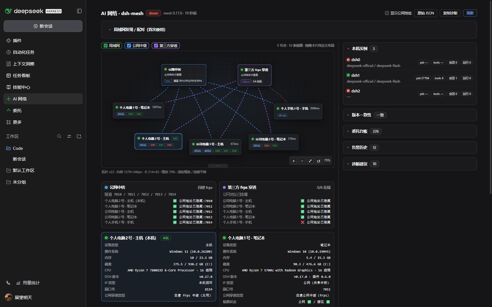

# dsh-mesh

**把多台电脑和手机组成一个可互相委托、可直控桌面的 AI 网络。**

**A multi-node AI network for [DeepSeek Harness](https://github.com/deepseek-ai/deepseek-harness): turn your PCs and phones into one mesh where agents can delegate work across devices and operate desktops directly.**

> Status: **0.0.1 — early preview**. APIs and package layout may change. Issues/PRs welcome.



*AI 网络左侧栏页面：拓扑、节点健康、链路与委托。公网 IP/域名默认隐藏；局域网地址可显示。*

## Why / 为什么

一台机器上的 AI 看不到你另一台电脑的窗口、文件和应用。dsh-mesh 让每一台装了 DSH 的设备成为网络里的一个**对等节点**：

- 每台设备既是 **host**（能被委托、被控制）也是 **controller**（可委托、可控制别人）
- 跨设备任务用**委托协议**（任务信封 + 状态机 + 结果落盘），而不是靠人转发
- 手机可以直接锁屏 / 显示桌面 / 关闭窗口 / 打开应用 / 操作浏览器，延迟约 0.5 秒
- 节点之间通过自建中继（frps）在公网互通，也可只在局域网使用

## Packages

| Package | What it does | Install |
|---|---|---|
| [`dsh-mesh-node`](https://www.npmjs.com/package/dsh-mesh-node) | Mesh server: exposes a machine to peers over MCP/HTTPS, with delegation + optional desktop-control tools | `npm i -g dsh-mesh-node` |
| [`dsh-mesh-host`](https://www.npmjs.com/package/dsh-mesh-host) | DSH host-side bridge: lets the mesh server drive local sessions/tools | `dsh plugin --profile web add dsh-mesh-host` |
| [`dsh-mesh-ui`](https://www.npmjs.com/package/dsh-mesh-ui) | DSH left-sidebar AI network page: topology, peer health, LAN onboarding, delegation list | `dsh plugin --profile web add dsh-mesh-ui` |
| [`dsh-mesh-autostart`](https://www.npmjs.com/package/dsh-mesh-autostart) | Keeps the mesh server alive across DSH engine restarts (useful on phone/desktop apps) | `dsh plugin --profile web add dsh-mesh-autostart` |

## AI 网络界面 / AI network UI

`dsh-mesh-ui` 现在是一个**左侧栏页面**（不再挤在设置页）：

- **拓扑图**：节点、链路、延迟、版本一致性；可拖拽内容宽度、分栏和画布。
- **局域网发现 / 配对**：扫描同网段节点 → 生成/输入一次性配对码 → 直接配对，不需要 frp、套餐或公网服务器。
- **链路检查**：对发现的节点一键测试 TCP/TLS 连通性和延迟。\n- **联邦拓扑（L1，只读）**：接入一个已配对的节点后，拓扑会显示经它可达的 1 跳间接节点（灰色虚线、标注「经 X」）；不提供委托或写操作。
- **隐私**：公网 IP/域名默认显示为「公网地址已隐藏」；页头「显示公网地址」开关可手动展开，选择会记忆。
- **局域网优先**：同一局域网只改 `node.bind=0.0.0.0` 即可；跨公网才需要 relay/frps。

## How it works / 架构

```
                    +------------------------------+
                    |        Relay / Control Plane |
                    |  frps tunnels (self-hosted)  |
                    +--------------+---------------+
         TLS + per-peer token     |
   +---------------+--------+------+--------+---------------+
   |               |        |               |               |
+--+---+       +---+--+  +--+---+       +---+--+       +----+----+
| PC 1 |<----->| PC 2 |  | PC 3 |<----->| PC 4 |       | Phone   |
| DSH  |       | DSH  |  | DSH  |       | DSH  |<----->| dsh-go  |
| mesh |       | mesh |  | mesh |       | mesh |       | mesh    |
+------+       +------+  +------+       +------+       +---------+
   每个节点 = DSH 引擎 + mesh server + host bridge + 可选桌面 helper
```

- **mesh server**（`dsh-mesh-node`）：每节点一个 MCP-over-HTTPS 服务，暴露工具给 peer。
- **host bridge**（`dsh-mesh-host`）：DSH 宿主插件，让 mesh server 能创建会话、发消息、调用本机工具。
- **relay**：一台有公网的 VPS 跑 frps 即可让 NAT 后的节点互通（TLS + token + 指纹 pin）。
- **桌面直控**（可选，默认关闭）：`pc_action` / `pc_app` / `pc_window` / `pc_browser`。

## Security / 安全\n\n- **扫描只发现，不自动连接**：局域网发现只列出节点；建立连接必须由一方生成一次性配对码、另一方输入兑换。空码请求会被服务端拒绝。\n- Discovery broadcasts only node name/URL/cert fingerprint on the LAN (no tokens). Pairing requires a one-time code; codes expire and are single-use.

- 远程桌面控制默认**关闭**，需在目标节点显式开启
- 每个 peer 独立 token + 最小 ACL；deny-by-default；审计日志；限频
- TLS 证书指纹 pin，中继只转发流量，不持有凭据
- 建议只在你自己的设备之间使用；详见 [SECURITY.md](SECURITY.md)

- 开发历程（为什么从局域网走到自建公网中继）：[docs/HISTORY.md](docs/HISTORY.md)

## Repository layout

```
packages/dsh-mesh-node/        mesh server (MCP/HTTPS, tools, delegation)
packages/dsh-mesh-host/        DSH host bridge plugin
packages/dsh-mesh-ui/          DSH left-sidebar AI network page + LAN onboarding
packages/dsh-mesh-autostart/   engine-restart supervisor plugin
tools/                         helper scripts (PC session-0 helper, phone kit, ops)
docs/                          architecture notes
```

## Roadmap

- [x] 0.0.1 — 公开源码 + 4 个 npm 包
- [ ] 0.1.0 — 一键入网（邀请码）、Windows 安装器、完善文档
- [ ] 0.2.0 — dsh-go 插件市场一键安装、手机端体验
- [ ] later — 多 relay 高可用、P2P 打洞、更多平台

## 让 AI 自己安装 / Let your agent install

把下面这段直接发给你的 DSH AI：

```
请帮我安装 dsh-mesh 插件，按 https://github.com/LinYanZhi/dsh-mesh/blob/main/docs/INSTALL-FOR-AGENTS.md 执行：
1) 确认 Node >= 22、DSH >= 0.2.0-rc.2，找到我当前使用的 DSH profile
2) 安装并验证 dsh-mesh-host / dsh-mesh-ui / dsh-mesh-autostart
3) 需要重启 DSH 时先问我；不要开启远程桌面控制（pcControl）
4) 每一步报告验证结果，失败就停下来
```

- 写给 AI 的完整安装手册：[docs/INSTALL-FOR-AGENTS.md](docs/INSTALL-FOR-AGENTS.md)
- 给人看的安装指南：[docs/INSTALL.md](docs/INSTALL.md)
- 仓库根目录的 [AGENTS.md](AGENTS.md) 也会被大多数 coding agent 自动读取
## Contributing

See [CONTRIBUTING.md](CONTRIBUTING.md). 中文/English both welcome.

## License

MIT — see [LICENSE](LICENSE).
